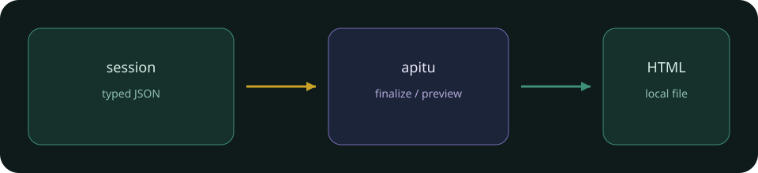
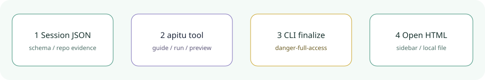

<div align="center">
  
  <h1>apitu</h1>
  <p><strong>Turn the current session’s ideas and code evidence into local interactive HTML diagrams.</strong></p>
  <p>DeepSeek Harness desktop plugin: Chinese sidebar + the <code>apitu</code> tool. No extra model account or API key.</p>
  <p><a href="README.md">简体中文</a> · <strong>English</strong></p>
  <p><a href="package.json">v1.2.3</a> · <a href="LICENSE">MIT</a> · <a href="https://github.com/topics/dsh-plugin">dsh-plugin</a></p>
  <p><a href="#install-and-use">Install</a> · <a href="#capabilities-and-limits">Capabilities</a> · <a href="#execution-policy-123">Execution policy</a> · <a href="#runtime">Runtime</a> · <a href="#development-checks">Checks</a></p>
</div>

Local DSH plugin: turn ideas, requirements, or repository evidence from the current session into interactive HTML diagrams. It ships a Chinese sidebar and a native `apitu` tool. It does not need a separate model account or API key.



## Install and use

Plugin version `1.2.3`, vendored core id `3.1.0`, with local defect fixes. This is not an upstream core release. Desktop loads it as a **profile bundle** (`dependencies` + `dsh.profile.bundles`); the package patch `name` is `apitu`. After edits, **quit DeepSeek Harness with ⌘Q and reopen**. A written file does not prove the desktop loaded the new code. After restart, confirm `version: "1.2.3"` via the `guide` tool or the sidebar GET for this session, then check tasks, session policy, and preview. A stale `1.2.2` response from an old process is not proof.

```sh
export DSH_HOME="${DSH_HOME:-$HOME/.dsh}"
git clone https://github.com/yueyexiayu/dsh-apitu.git "$DSH_HOME/plugins/apitu"
```

Then add `apitu` to `$DSH_HOME/profiles/desktop/package.json` `dependencies` (`link:` to that directory) and `dsh.profile.bundles`, run `pnpm install` in the profile, and ⌘Q. Do not also `insert` the same id.

1. In chat, ask to draw an architecture or payment flow with apitu. The current session model reads source/requirements, writes schema JSON, then calls the plugin.
2. Open the **apitu** sidebar tab and set the project’s absolute working directory. The sidebar binds the live session; Host queries the real session and applies the same filesystem policy as the chat tool. It does not take a policy mode from the frontend, and it does not fall back to Host default policy when no session is present. Default type is `roadmap`.
3. Default `roadmap` is the api-sheji dual-SVG Chinese station map: zoom/pan, F/A numbers, click hints, route filters, and moving packets. **It does not implement the legacy viewer themes, search, presentation, or PNG/SVG/WebM export.** The original five types still keep those viewer features.

### Chat tool

```json
{"action":"guide"}
```

Returns authoring entry points, the bundled core path, and skill text. Keep reading with `nextOffset`; truncated text is not the full spec.

Write JSON with ordinary DSH file tools, then:

```json
{
  "action":"run",
  "cwd":"/absolute/project",
  "args":["finalize","architecture","candidate.json",".apitu/new-run/diagram.html","--json"]
}
```

`finalize` runs validate → deliver → check → browser-check. **Automated checks are not a human visual review.** `ok:false`, a non-zero `exitCode`, `stderr`, or a failed receipt gate must be fixed before delivery. An output file existing is not success.

## Capabilities and limits

- Six types: `roadmap`, `architecture`, `workflow`, `sequence`, `dataflow`, `lifecycle`.
- CLI includes `render`, `compare architecture`, `deliver`, `finalize`, `preview`, `validate`, `migrate workflow`, `inspect architecture|roadmap`, `check`, `browser-check`, `visual-check`, `guide`, `brands`, `examples`, `doctor`, `demo`, `help`.
- Core lives in `vendor/core`; CLI entry is `vendor/core/bin/apitu.mjs`.
- CLI subprocesses cannot inherit a restricted DSH filesystem sandbox, so execution requires `danger-full-access`. Unknown, read-only, and workspace-write modes fail closed. Reading plugin docs is not blocked.
- cwd must come from the real session directory or an explicit user path, never the Host process directory. The sidebar GET prefills that session cwd; the user can still change it. Local filesystem only.
- Ordinary tasks cap at 180 seconds and 2 MiB output. One running job per session; other sessions are not blocked. Host unload stops previews through `ctx.effect`; preview stop signals the process group.

## Execution policy (1.2.3)

Automatic browser-check / visual-check / finalize use owned, anonymous, true-headless `web-regression` batches. They do not borrow the Chrome extension, the user login profile, or a native window. There is no anonymous or GUI fallback.

The shared resolver artifact in `vendor/browser-execution/` is the same source-provenance closure consumed by chrome/huoqu. Current private off-cycle browser-use tarball is `0.2.1-alpha.2.browser-policy.1`. Vendored core `3.1.0` is an upstream identity, not this plugin package version.

## Runtime

- Node.js ≥18. This machine uses `/usr/local/bin/node`. `APITU_NODE` may set an absolute path.
- Ordinary rendering does not need a browser. Browser commands need this plugin’s pinned `playwright-core@1.58.2`.
- `finalize` and browser/visual checks use that version’s dedicated headless shell (revision `1208`, real version `145.0.7632.6`). No GUI fallback.
- Only macOS arm64 has a verified install manifest. x64/Rosetta, Linux, and Windows are `unsupported/unverified`.

```sh
/usr/local/bin/node /usr/local/lib/node_modules/npm/bin/npm-cli.js ci --ignore-scripts
PLAYWRIGHT_BROWSERS_PATH=0 /usr/local/bin/node node_modules/playwright-core/cli.js install chromium-headless-shell
PLAYWRIGHT_BROWSERS_PATH=0 /usr/local/bin/node --test test/*.test.mjs
```

## Development checks

```sh
/usr/local/bin/node --test test/*.test.mjs
```

Tests cover Host/API/policy/errors/preview lifecycle, Client behavior, six render types, and isolated Chrome checks. They write temporary artifacts and do not control the user’s windows. Automated tests do not replace a desktop sidebar check after ⌘Q.

Public repository: https://github.com/yueyexiayu/dsh-apitu . The community catalog scans topic `dsh-plugin`; full listing still needs their human review. This repo does not open a self-nomination PR.

<div align="center"><sub>apitu · <a href="README.md">阅读中文 →</a></sub></div>
