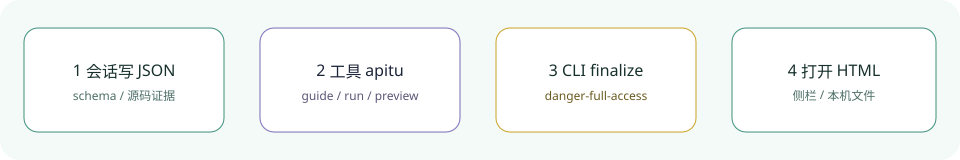

<div align="center">
  
  <h1>apitu</h1>
  <p><strong>把当前会话里的想法和代码证据做成可交互的本地 HTML 图。</strong></p>
  <p>DeepSeek Harness 桌面插件：中文右侧栏 + 工具 <code>apitu</code>。不另配模型账号或 API Key。</p>
  <p><strong>简体中文</strong> · <a href="README.en.md">English</a></p>
  <p><a href="package.json">v1.2.3</a> · <a href="LICENSE">MIT</a> · <a href="https://github.com/topics/dsh-plugin">dsh-plugin</a></p>
  <p><a href="#安装与使用">安装与使用</a> · <a href="#完整能力与边界">能力与边界</a> · <a href="#执行策略123">执行策略</a> · <a href="#运行环境">运行环境</a> · <a href="#开发验证">验证</a></p>
</div>

本地 DSH 插件：把当前会话中的想法、需求或代码证据制作成交互式 HTML 图。提供中文右侧栏与原生 `apitu` 工具；不需要另配模型账号或 API Key。



## 安装与使用

当前执行策略接入版为插件 `1.2.3`，vendored core 标识 `3.1.0`，带本地缺陷修复，不冒充上游新发行版。本机按 **profile bundle** 加载（`package.json` 的 `dependencies` + `dsh.profile.bundles`），包内 patch 的 `name` 为 `apitu`。修改后请 **⌘Q 完全退出 DeepSeek Harness 后重新打开**；文件已写入不能单独证明桌面加载了最新版。重启后用工具 `guide` 或当前会话的侧栏 GET 响应确认 `version: "1.2.3"`，再验收任务列表、会话策略和预览；旧进程的 `1.2.2` 响应不能证明新代码已生效。

```sh
export DSH_HOME="${DSH_HOME:-$HOME/.dsh}"
git clone https://github.com/yueyexiayu/dsh-apitu.git "$DSH_HOME/plugins/apitu"
```

然后把 `apitu` 写进 `$DSH_HOME/profiles/desktop/package.json` 的 `dependencies`（`link:` 到该目录）和 `dsh.profile.bundles`，在 profile 目录执行 `pnpm install`，⌘Q 重开。不要再对同一 id 做 desktop `insert`。

1. 在对话中说“用 apitu 给这个项目画架构图”或“用 apitu 画订单支付流程”。当前会话模型负责读源码/需求、生成符合 schema 的 JSON，再调用插件。
2. 右侧栏选择 **apitu**，填写项目的绝对工作目录。侧栏关联当前存活会话，由 Host 查询真实会话并应用与对话工具一致的文件策略，不接受前端指定策略模式，也不在缺少会话时回退 Host 默认策略。默认选择 `roadmap`，可生成六类示例、把已有 JSON 渲染成图、查看本会话的对话/侧栏任务结果并打开 HTML。
3. 默认 `roadmap` 使用 api-sheji 风格中文双 SVG 站点地图：缩放/平移、F/A 编号、点击提示、路线筛选与流动光点，保留规则/消费/生命周期/页面命令/边界/核对日期。**不含旧 viewer 的主题、搜索、演示或 PNG/SVG/WebM 导出**；窄屏默认显示局部，需拖动查看；滚轮缩放可调整全图/标签阅读，不提供双指缩放或 +/- 放大按钮。原五型仍保留主题、搜索、关系追踪、演示和导出。

### 对话工具

```json
{"action":"guide"}
```

返回创作入口、内置核心路径和 skill 正文。继续按 `nextOffset` 读取文档，不能以截断内容冒充完整规范。

```json
{"action":"read","resource":"schemas/architecture.schema.json","offset":1,"limit":180}
```

用 DSH 文件工具写好 JSON，再执行（目录仅为示例）：

```json
{
  "action":"run",
  "cwd":"/absolute/project",
  "args":["finalize","architecture","candidate.json",".apitu/new-run/diagram.html","--json"]
}
```

`finalize` 执行 validate → deliver → check → browser-check。**自动检查通过不等于人工视觉检查通过**。输出 `ok:false`、非零 `exitCode`、`stderr` 或 receipt gate 失败时必须修复后再交付；产物存在不代表任务成功。

## 完整能力与边界

- 六种类型：`roadmap`、`architecture`、`workflow`、`sequence`、`dataflow`、`lifecycle`。Roadmap 规范/示例为 `vendor/core/references/roadmap.md`、`vendor/core/schemas/roadmap.schema.json`、`vendor/core/examples/apitu-plugin.roadmap.json`。`roadmap-v1` 有自己的静态与真实 Chrome 双视口门禁，不伪造旧 viewer/theme/export PASS。`visual-check` 不支持 roadmap 的旧式主题/导出截图验收，明确失败；使用 `browser-check`。
- CLI：`render`、`compare architecture`、`deliver`、`finalize`、`preview`、`validate`、`migrate workflow`、`inspect architecture|roadmap`、`check`、`browser-check`、`visual-check`、`guide`、`brands`、`brands capture`、`examples`、`doctor`、`demo`、`help`。
- `recover-output` 为独立恢复入口，涉及已有产物，只在明确需要时按其帮助使用。
- 核心位于 `vendor/core`，CLI 入口为 `vendor/core/bin/apitu.mjs`，包含 schema、校验器、单文件 viewer、布局器、品牌目录、示例、迁移器和证据/回执。
- Mermaid/自然语言/仓库证据创作由当前 AI 阅读 skill 并转换为 typed JSON，不是独立 Mermaid CLI 解析器或额外模型服务。
- `inspect` 支持 architecture 和 roadmap；compare 仍仅 architecture，migrate 仍仅 workflow。
- `preview` 是持续运行的本机实时预览，启动后返回 `preview.id` 和 URL，修改输入 JSON 可热更新。`processStatus` 表示进程是否运行；`buildStatus` 独立表示 `checking`、`verified`、`needs-fix` 或状态不可获取，带 generation、failure 和 lastVerified。启动成功不等于构建通过；侧栏显示“预览运行中”与实际构建状态。
- 成功构建的 HTML 经大小与 SHA-256 核对后进入任务产物列表；构建失败时保留诊断，不把旧版说成新版成功。用 `preview-status` 查询，或 `stop-preview` 停止；本会话的对话/侧栏预览均可在侧栏停止。停止后已验证的磁盘产物仍可打开。关闭 Host 时清理所有 preview，不替换 DSH GUI。
- `examples` 会改写自己包中的示例，因此适配层在工作目录 `.apitu/examples-*` 建立独立核心副本执行，保持安装目录不变。`demo` 使用独立的新产物目录。
- 写命令要求显式指定**新**产物路径，提交阶段通过原子 no-clobber 发布保护已有文件，包括 Host 预检后并发出现的文件；显式 `--receipt` 和 `--out-dir` 也必须是新路径。`migrate --output` 仅设置 JSON 元数据。
- 失败或视觉修复后重跑完整 `finalize`，保留旧产物并使用新 revision 的 HTML，例如 `.apitu/new-run/repair-2/diagram.html`，有 `meta.output` 时同步调整，并换新显式 receipt/evidence 路径。**只改变 `--out-dir` 不够**；即使候选内容没变，只要旧 HTML 已产生也不能复用。不要删除旧证据或绕过策略改用裸 CLI。预览只允许继续更新当前进程自己已发布且未被第三方更改的产物。
- CLI 子进程不能继承受限 DSH 文件沙箱，因此只在 `danger-full-access` 策略下执行；未知、只读和 workspace-write 模式明确拒绝。读取插件内文档不受此限制。
- cwd 必须来自真实会话目录或用户显式填写，不用 Host 进程目录猜测。侧栏 GET 会返回当前会话 cwd 供预填，用户仍可改。仅支持本地文件系统。
- 普通任务最多运行 180 秒，输出上限 2 MiB；超限/取消明确失败。持续 preview 就绪后不受普通任务期限限制，但同时最多 8 个活动预览；结束预览最多保留 32 条、30 分钟，超过容量/期限会回收内存记录。对话与侧栏共用最近任务注册表；同一会话同时只能有一个 running 任务，不同会话互不阻塞。终态任务最多约 30 条/24 小时，活动任务不会因历史上限被提前丢失；重启不删除磁盘产物。Host 卸载通过 `ctx.effect` 停止预览，preview 停止信号发给进程组。

## 执行策略（1.2.3）

所有自动 browser-check/visual-check/finalize 使用 owned、anonymous、true headless 的 `web-regression` 批次；不借 Chrome 扩展、用户登录 profile 或原生窗口。backend 是 CDP pipe。Host 把真实 Session ID、job/task batch 与 operation cwd 传给 CLI；直接 CLI 使用自己的进程 session/batch，不能误报为用户会话。receipt 记录 execution request、真实 scope/backend/mode/ownership/identity、固定磁盘 identity 与运行中 `Browser.getVersion`，无匿名或 GUI fallback。

默认 resolver、finalize 预构造，以及直接 `new ChromeVisualBrowser(explicitPath, options)` 均验证实际 pin package/完整二进制安装，再由官方 core 验证最终 launch 参数。显式 GUI/脚本/其他版本/错误 mode 在 spawn 前拒绝，不靠调用者填写 `kind` 或 `verified` 自证。当前 adapter 不支持独立 context lease、authenticated-state 或私有原生下载目录请求，明确能力错误，不以空操作冒支持；导出通过本任务 CDP/文件事务写入其明确输出路径。生产 constructor/launch-args 不接受 `spawnImpl`/`getuid`，browser/visual/finalize 不接受 `browserFactory`/`createBrowser`/`resolveChrome` 等旧 acquisition hooks；未知 options 在 resolver、profile、receipt 或 artifact 操作之前明确拒绝，测试改用 test-only builtin mock/VM。finalize 通过模块私有认证的真实 owned handle 复用一个 browser；engine/scope/original sessionPromise/实际 runtime metadata 不取可覆盖的 instance property，缺失 metadata、伪造 prototype、closed/closing 或 scope 不符明确失败，不用 unreported metadata 假装 gate 通过。

通用 resolver 来自 `vendor/browser-execution/` 的同一官方 source-provenance artifact，与 Chrome/huoqu 消费同一 SHA；五包闭包相对 file 依赖与实际 npm lock 固定。插件只保留静态 pin JSON/tiny wrapper，不维护策略副本、公共旧 core 或绝对源码路径。共享产物升级需同步三个消费者 SHA 与安装锁。当前实际 private off-cycle 版本为 `0.2.1-alpha.2.browser-policy.1`，tarball SHA-256 `efae81d6fab57b12aa5c3a4663f42e379344b5a0a9b61b302a8ee55b3ae80b14`，source provenance SHA-256 `60bf07c6a6f8d5385aee45cb541128127e4645a3061532a93e6f1c47f88cc369`；不是官方 full release，也未修改已安装 ASAR。metadata 的 `policyPackage` 通过标准 package export 读取实际 installed version/localArtifactVersion/sourceSha256，不以 filename 或缓存常量自证。`vendor/core` 的 `3.1.0` 是 vendored 上游来源标识，并非本地插件包版本。

Host 管理的批次把 browser/visual receipt、finalize full/summary receipt 先写入本批次自有 TMPDIR，不提前在用户输出提交 pass。Host 等 CLI 与原组及已知后代退出，核对容器 canonical path/dev/ino 并删除成功后，才向从真实命令参数计算的精确目标以 no-clobber 提交；取消、CLI 失败或容器清理失败不提交 pass。中间 deliver HTML、截图或 contact sheet 存在不等于整批成功。Node 独立 CLI/library 没有 Host 容器，仍等待自己的 browser/profile 释放后按原事务发布。此处为源码行为说明，不代表当前运行 Host 已重载或真实故障验收已完成。

## 运行环境

- Node.js ≥18，本机使用 `/usr/local/bin/node`。可用 `APITU_NODE` 指定绝对路径。
- 普通渲染不需要浏览器。浏览器命令需要本插件本地精确依赖 `playwright-core@1.58.2`，由 `package-lock.json` 固定 npm registry URL/SHA-512 integrity。
- `finalize`、浏览器/视觉检查只使用该版本对应的专用 headless shell（revision `1208`，真实版本 `145.0.7632.6`），不扫描其他项目、不选择缓存最高 revision、不跨架构借用、不 GUI fallback。Host 源码修改仍须重启 DSH 才用于已加载工具。
- 兼容性变化：目前只有 macOS arm64 有经过验证的安装校验 manifest，真实验收系统为 macOS 27.0.1；x64/Rosetta、Linux、Windows 明确 `unsupported/unverified`，不再沿用 GUI 自动发现。Darwin major 低于22拒绝，其他 macOS 版本未做真实运行验收，不冒称已验收。

### 固定无头依赖

在本插件目录执行：

```sh
/usr/local/bin/node /usr/local/lib/node_modules/npm/bin/npm-cli.js ci --ignore-scripts
PLAYWRIGHT_BROWSERS_PATH=0 /usr/local/bin/node node_modules/playwright-core/cli.js install chromium-headless-shell
# 运行时保持相同安装语义
PLAYWRIGHT_BROWSERS_PATH=0 /usr/local/bin/node --test test/*.test.mjs
```

也可使用 `npm run install:headless` 安装到 Playwright 默认缓存。`PLAYWRIGHT_BROWSERS_PATH` 未设置/为空时采用 `~/Library/Caches/ms-playwright`；`0` 是本插件 `node_modules/playwright-core/.local-browsers`；绝对缓存原样使用，相对缓存按**执行 cwd**解析。PATH=0、empty/unset 与环境变量取值优先级遵循固定包：同名变量、`npm_config_playwright_browsers_path`、`npm_package_config_playwright_browsers_path` 依次优先，空字符串也占优先级。相对路径**刻意忽略 `INIT_CWD`**，遵循插件 execution cwd 契约，不等同 npm 启动时 Playwright 的全部路径语义。只寻找 `chromium_headless_shell-1208/chrome-headless-shell-mac-arm64/chrome-headless-shell`。

`APITU_CHROME` 未设置时使用固定安装；显式为空/空白/失效/不兼容时明确失败，不能 fallback。有效 override 可以指向别处完整的相同固定安装；相对路径按执行 cwd。解析检查本地 package/官方 browsers manifest、完成 marker、无活动安装锁、Mach-O/原生arm64、完整17文件 SHA-256 及真实 `--version`，不以文件名或 X_OK 自证。批次解析时验证，不在每个 CDP 操作重复 hash。依赖缺失或非法 override 返回非零、`ok:false`/`status:"fail"`、`browserUnavailable:true` 和具体原因；未执行门禁不填正常 metrics。这修复原先缺依赖时标为 `skipped` 的失败语义，不关闭真实错误。

版本来自官方 npm `playwright-core@1.58.2/browsers.json`。`vendor/core/bin/headless-browser.lock.json` 的 SHA-256 是本地对官方 CLI 下载字节计算并实际运行验证的测量值，**不是上游签名**；官方源为 `https://cdn.playwright.dev/builds/cft/145.0.7632.6/mac-arm64/chrome-headless-shell-mac-arm64.zip`。升级/扩平台需同步精确 dependency/lock、官方 browser manifest、完整安装测量值，并在真实目标OS/原生架构运行版本/DOM/截图及无 GUI 验收后开放；不能由目录最高 revision 自动扩兼容。
- `brands capture <url>` 是用户主动的联网操作，不能宣称所有命令完全离线。
- 原生“打开 HTML”使用 macOS `open`，不启动另一个 DSH 服务。

## 开发验证

```sh
/usr/local/bin/node --test test/*.test.mjs
```

覆盖 Host/API/策略/错误/预览生命周期、Client 行为、六型渲染与证据链，以及隔离 Chrome 中原五型主题/查找/PNG/SVG/WebM 下载与解码、roadmap 独立双视口 station/route/text 几何、提示/筛选/光点/缩放复位。测试生成独立临时产物，不控制用户窗口、不启动替代 GUI 服务。自动化测试不能替代桌面侧栏验收；桌面需重启后验证。

公开仓库：https://github.com/yueyexiayu/dsh-apitu 。社区目录扫描 Topic `dsh-plugin`；进全量目录仍需对方人工核实，本仓库不提交自荐 PR。

<div align="center"><sub>apitu · <a href="README.en.md">Read in English →</a></sub></div>
